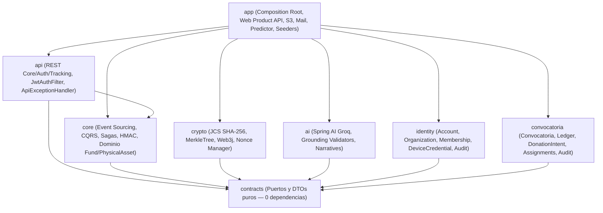
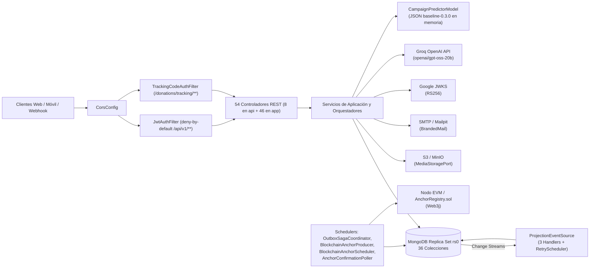
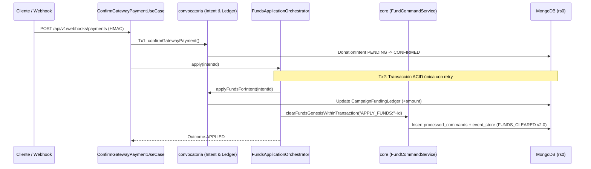
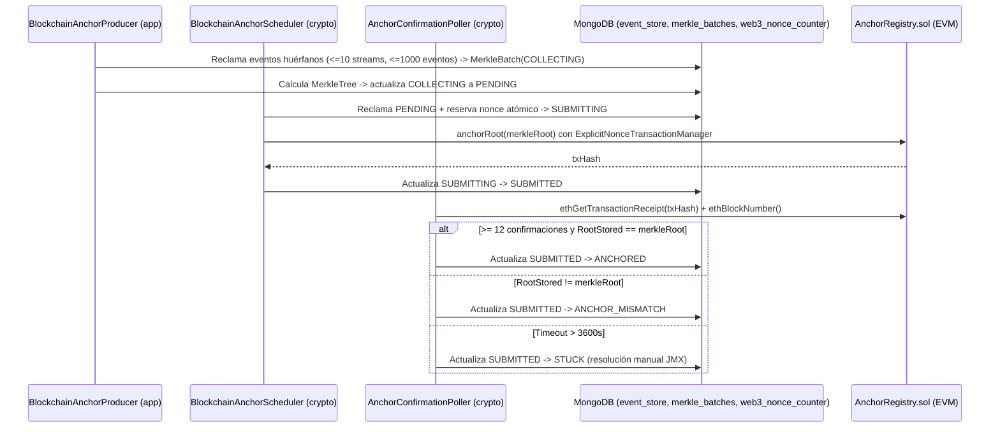
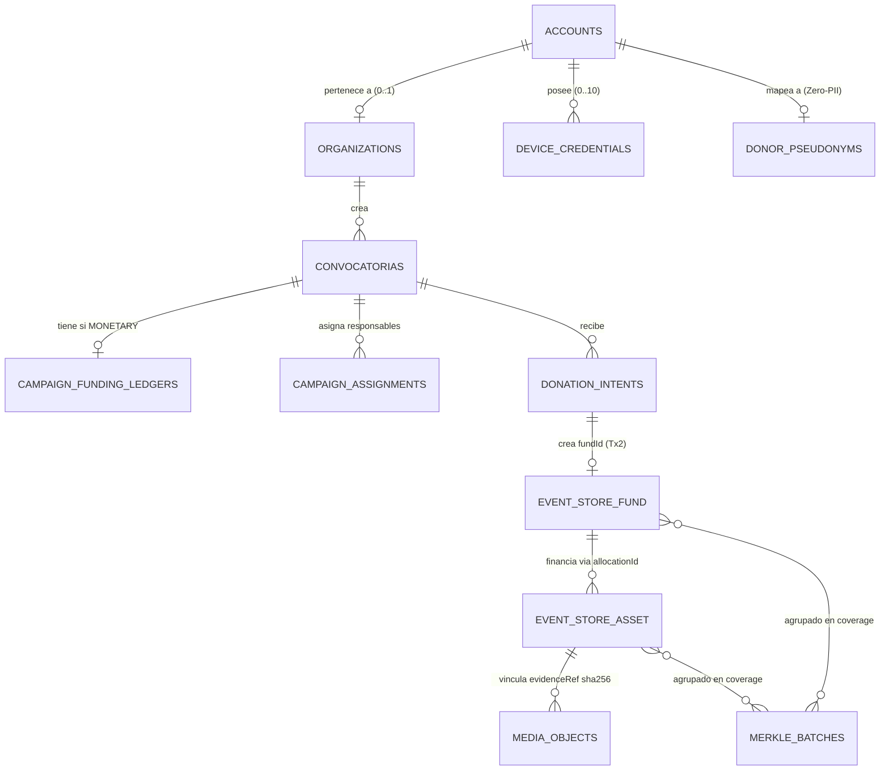

# Documentación Técnica de Ingeniería y Arquitectura — PaxFide (Sistema de Trazabilidad Verificable de Donaciones)

> **Estado de referencia del código auditado:** Rama `develop` en el commit `86933a4c` (`2026-11-24`), con **2 262 pruebas automatizadas** en verde verificadas en la última evidencia de CI local del código fusionado ([`ci-local-12aa498-2026-11-19T19-35-10Z.txt`](file:///home/carlos/Proyectos/Donaciones/Documentos/evidencia-ci/ci-local-12aa498-2026-11-19T19-35-10Z.txt): `core`: 448, `crypto`: 62, `ai`: 48, `api`: 177, `identity`: 448, `convocatoria`: 272, `app`: 807; `contracts`: 0).
> **Criterio documental:** Toda afirmación de este documento refleja la implementación **real** verificada directamente en el código fuente del repositorio. Se distingue explícitamente entre **hechos comprobados** (respaldados por el código fuente y los ADRs vigentes), **inferencias derivadas del código** y **recomendaciones técnicas**.

---

## 01. Introducción

### 1.1 Nombre del proyecto
- **Nombre comercial provisional (no usado en código):** **PaxFide**
- **Artefacto raíz Maven:** `com.traceability:traceability-parent:1.0.0-SNAPSHOT` ([`pom.xml`](file:///home/carlos/Proyectos/Donaciones/pom.xml))
- **Nombre de aplicación Spring:** `traceability-engine` ([`application.yml`](file:///home/carlos/Proyectos/Donaciones/app/src/main/resources/application.yml))
- **Clase de arranque:** [`com.traceability.app.TraceabilityApplication`](file:///home/carlos/Proyectos/Donaciones/app/src/main/java/com/traceability/app/TraceabilityApplication.java)

### 1.2 Descripción general
**PaxFide** es una plataforma backend de trazabilidad verificable para donaciones humanitarias construida sobre **Java 21** y **Spring Boot 3.4.4** como un **Monolito Modular Hexagonal** de 8 módulos Maven, complementado por un componente offline de Machine Learning en Python (**`paxfide-predictor`**) y un contrato inteligente Solidity (**`AnchorRegistry.sol`**).

El sistema combina **Event Sourcing + CQRS** para el núcleo financiero y logístico (`core`), **CRUD transaccional con bitácora de auditoría append-only** para identidad y convocatorias (`identity`, `convocatoria`), **encadenamiento criptográfico JCS (RFC 8785) + SHA-256 + árboles de Merkle anclados en EVM** (`crypto`), **narrativas de transparencia asistidas por LLM con validación determinista anti-alucinación** (`ai`) y **evaluación nativa de predicción de campañas** (`app` + `paxfide-predictor`).

### 1.3 Problema que resuelve
1. **Opacidad en la ejecución de donaciones:** Permite seguir el ciclo completo desde la intención de donación y el ingreso financiero (`Fund`) hasta la adquisición/registro de bienes físicos (`PhysicalAsset`), su despacho, recepción, división jerárquica en sub-lotes y entrega final con evidencia fotográfica y ubicación DIVIPOLA sellada.
2. **Riesgo de manipulación retroactiva:** Impide alterar hechos históricos sin detección matemática mediante un Event Store append-only encadenado (`previousHash -> eventHash`), anclado en lotes de Merkle en blockchain EVM y verificable mediante recálculo completo del payload canónico.
3. **Privacidad vs. transparencia pública (Zero-PII en Event Store y Blockchain):** Protege datos personales de donantes y beneficiarios mediante seudónimos opacos (`DonorPseudonymService`), credenciales HMAC-SHA256 sin estado (`HmacTrackingCodeService`, `HmacAssetRefService`), sanitización de metadatos EXIF/GPS en imágenes (`ImageSanitizer`) y copias censuradas pixeladas de evidencia de entrega (`EvidenceRedactor`).

### 1.4 Objetivos del sistema
- Garantizar la integridad criptográfica verificable extremo a extremo de cada transición financiera y logística.
- Mantener consistencia entre agregados y módulos sin transacciones distribuidas 2PC, usando **Transactional Outbox + Sagas orquestadas** (`OutboxSagaCoordinator`) y orquestación transaccional con recuperación (`FundsApplicationOrchestrator`).
- Exponer transparencia comprensible al donante y al público general mediante proyecciones CQRS, pruebas de inclusión de Merkle por transición y narrativas de IA con *grounding* determinista.
- Aplicar seguridad HTTP *deny-by-default* con aislamiento estricto por organización y control de acceso basado en roles.

### 1.5 Alcance real implementado
El repositorio contiene el backend completo y las herramientas de soporte operativo y analítico:
- **Identidad y Gobernanza (`identity`):** Cuentas con verificación de correo, login con contraseña (BCrypt coste 12), Google OAuth (RS256/JWKS), login biométrico por credencial de dispositivo (`DeviceCredential`), recuperación y cambio de contraseña con revocación de sesiones (`credentialsNotBefore`), aceptaciones legales, organizaciones (`FOUNDATION`, `COMPANY`) con validación de NIT DIAN y flujo de verificación institucional (`PENDING_VERIFICATION`, `NEEDS_MORE_INFORMATION`, `VERIFIED`, `REJECTED`), membresías (`REPRESENTATIVE`, `ADMINISTRATOR`, `EMPLOYEE`), invitaciones por correo y autoridad de plataforma.
- **Convocatorias y Recaudación (`convocatoria`):** Campañas (`OPEN` / `CLOSED`) monetarias y/o en especie, ledger contable (`CampaignFundingLedger`) con políticas de meta (`STRICT`, `FLEXIBLE`, `CLOSE_ON_TARGET`), intenciones de donación (`GATEWAY`, `BANK_TRANSFER`), asignación de responsables y solicitudes de cambio de configuración con doble aprobación.
- **Núcleo Event-Sourced y CQRS (`core`):** Agregados `Fund` y `PhysicalAsset`, Event Store transaccional MongoDB, sagas de registro y división de activos, 3 proyectores por Change Streams con cuarentena y reintentos, soporte de fechas simuladas controladas (`EventTime`) para el perfil `demo-historico`, verificación recalculada de hashes y autorización por organización/rol (incluida lectura de lote para `ADMINISTRATOR`, `REPRESENTATIVE` y `EMPLOYEE`, ADR-032 Enm. 1).
- **Criptografía y Anclaje (`crypto`):** Canonicalización JCS, árboles de Merkle y pruebas de inclusión, gestor explícito de nonce en MongoDB sincronizado con la cadena (`NonceCounterChainSync`), envío y confirmación vía Web3j, reconciliación ante `"nonce too low"` y consola JMX administrativa.
- **IA (`ai`) y Predictor (`paxfide-predictor` + `app`):** Narrativas de donación individual (con caché en MongoDB y fallback en español) y de convocatoria (caché en memoria), más modelo predictivo `baseline-0.3.0` (regresión logística + `HistGradientBoostingRegressor`) ejecutado nativamente en Java sin Python en runtime.
- **Multimedia y Evidencia (`app`):** Almacenamiento en S3/MinIO (o local en `dev`), sanitización en memoria por JDK, fotos de entrega y fotos opcionales por paso (`REGISTERED`, `DISPATCHED`, `RECEIVED`), generación bajo demanda de copias censuradas pixeladas y publicación controlada exclusivamente por `ADMINISTRATOR`.

### 1.6 Características principales
- **Doble régimen de persistencia (comprobado, ADR-025/037/038):** Event Sourcing en `core`; CRUD transaccional con bitácora append-only en `identity` e `identity_audit_log`, y en `convocatoria` y `convocatoria_audit_log`.
- **Fronteras de módulo verificadas en compilación/test:** Reglas **ArchUnit** activas en `core`, `crypto`, `ai`, `api`, `identity`, `convocatoria` y `app`.
- **Evolución de esquemas sin migración destructiva:** 28 payloads registrados en `EventPayloadRegistry` (p. ej. `ASSET_REGISTERED` v1.0 hasta v5.0), preservando compatibilidad de hashes históricos.

---

## 02. Tecnologías y herramientas

### 2.1 Lenguajes y versiones
| Lenguaje | Versión | Uso comprobado en el repositorio |
|---|---|---|
| **Java** | **21 (LTS)** (`maven.compiler.source/target = 21`) | Los 8 módulos Maven del backend ([`pom.xml`](file:///home/carlos/Proyectos/Donaciones/pom.xml)). |
| **Solidity** | **`^0.8.0`** | Contrato inteligente [`AnchorRegistry.sol`](file:///home/carlos/Proyectos/Donaciones/crypto/src/test/resources/solidity/AnchorRegistry.sol) compilado a `.abi`/`.bin` para generación de wrappers Web3j. |
| **Python** | **>= 3.11** | Entrenamiento offline del predictor ([`paxfide-predictor/`](file:///home/carlos/Proyectos/Donaciones/paxfide-predictor/)), scripts de exportación/paridad (`scripts/predictor/`), demo (`scripts/demo/recorrido.py`, `datos-prueba.py`) y pruebas de mutación (`scripts/mutaciones.py`). |
| **Bash** | POSIX/GNU | Scripts de CI local ([`scripts/ci-local.sh`](file:///home/carlos/Proyectos/Donaciones/scripts/ci-local.sh)) y operación del servidor de pruebas ([`scripts/servidor/paxfide.sh`](file:///home/carlos/Proyectos/Donaciones/scripts/servidor/paxfide.sh)). |

### 2.2 Frameworks y bibliotecas (verificadas en los `pom.xml`)
| Categoría | Artefacto | Versión exacta | Módulos | Propósito técnico |
|---|---|---|---|---|
| **Framework Base** | `spring-boot-dependencies` (BOM) | **`3.4.4`** | Todos excepto `contracts` | DI, Web MVC, Data MongoDB, Mail, Validation, Scheduling, Test. |
| **Inteligencia Artificial** | `spring-ai-bom` + `spring-ai-openai-spring-boot-starter` | **`1.0.0-M6`** | `ai`, `app` | `ChatClient` + `BeanOutputConverter` contra Groq (`https://api.groq.com/openai`, modelo por defecto `openai/gpt-oss-20b`). |
| **Blockchain / EVM** | `org.web3j:core` | **`4.12.0`** | `crypto` | Cliente JSON-RPC EVM, `RawTransactionManager`, decodificación de eventos `RootStored`. |
| **Codegen Web3j** | `org.web3j:web3j-maven-plugin` | **`4.9.4`** | `crypto` | Genera wrapper `AnchorRegistry` en `target/generated-sources/web3j`. |
| **Canonicalización** | `io.github.erdtman:java-json-canonicalization` | **`1.1`** | `crypto` | Canonicalización determinista JSON **RFC 8785 (JCS)** en `JcsHashAdapter`. |
| **JWT / OAuth** | `com.nimbusds:nimbus-jose-jwt` | **`10.10`** | `api`, `app` | Emisión/verificación HS256 con `kid` (`NimbusTokenIssuer`, `JwtTokenVerifier`) y verificación Google OAuth RS256/JWKS (`NimbusGoogleIdTokenVerifier`). |
| **Cifrado** | `org.springframework.security:spring-security-crypto` | BOM `3.4.4` | `identity`, `app` | BCrypt (coste 12) sin importar `spring-boot-starter-security`. |
| **Almacenamiento S3** | `software.amazon.awssdk:s3` + `url-connection-client` | **`2.55.10`** | `app` | Cliente S3/MinIO sobre el cliente HTTP nativo de la JDK (excluye Netty/Apache). |
| **Correo** | `spring-boot-starter-mail` | BOM `3.4.4` | `app` | Envío SMTP `multipart/alternative` (texto + HTML) con plantillas propias (`MailTemplates`). |
| **Identificadores** | `com.github.f4b6a3:ulid-creator` | **`5.2.3`** | `identity`, `app` | Generación de ULIDs ordenables (`AccountId`, `OrganizationId`, `objectKey` de media). |
| **Utilidades** | `org.projectlombok:lombok` | BOM `3.4.4` | `core`, `identity` | Reducción de boilerplate solo en capas permitidas (`provided`/`optional`). |
| **Testing** | JUnit 5, Testcontainers (`mongodb`, `junit-jupiter`), `maven-surefire-plugin` | Surefire `3.5.4` | Todos excepto `contracts` | Pruebas unitarias y de integración contra MongoDB real en Replica Set. |
| **Arquitectura** | `com.tngtech.archunit:archunit-junit5` | **`1.3.0`** (`core`, `crypto`, `ai`, `identity`, `convocatoria`) / **`1.2.1`** (`api`, `app`) | 7 módulos | Verificación automatizada de fronteras de dependencia y reglas arquitectónicas. |
| **ML Offline (Python)** | `numpy`, `pandas`, `scikit-learn`, `matplotlib`, `joblib` | `scikit-learn 1.9.1` (artefacto `0.3.0`) | `paxfide-predictor` | Generación sintética, entrenamiento, evaluación y exportación a JSON determinista. |

> **Nota verificada:** No existe `jacoco-maven-plugin` ni dependencia de `Awaitility` declarada en los `pom.xml` del repositorio (a diferencia de lo que figuraba en documentación previa).

### 2.3 Bases de datos e infraestructura
- **MongoDB (6.0 en Docker Compose / Testcontainers; compatible 7.0) en modo Replica Set (`rs0`):** Requerido obligatoriamente para transacciones multi-documento ACID (`MongoTransactionManager` / `CommitRetryingMongoTransactionManager`) y **Change Streams** (`ProjectionEventSource`). Aloja **35 colecciones `@Document`** más 1 colección escrita directamente por `MongoTemplate` (`saga_manual_actions`) = **36 colecciones totales**.
- **Almacenamiento de objetos S3 / MinIO:** Bucket privado con `forcePathStyle(true)` para logos, portadas y evidencias fotográficas. En perfil `dev` puede sustituirse por almacenamiento local en `${java.io.tmpdir}/paxfide-media`.
- **Nodo EVM (Ganache local `chainId=1337` en demo; Sepolia `chainId=11155111` por defecto en `application.yml`; compatible Polygon Amoy):** Anclaje de raíces de Merkle vía `AnchorRegistry.anchorRoot(bytes32)`.
- **SMTP / Mailpit:** Envío de verificación de correo, invitaciones, recuperación de contraseña y avisos de seguridad (en `dev`, Mailpit en `localhost:1025` / UI `:8025`).
- **Groq API (compatible OpenAI):** Generación de narrativas IA en español (`openai/gpt-oss-20b`).

---

## 03. Arquitectura del sistema

### 3.1 Visión y estilo arquitectónico
El sistema implementa un **Monolito Modular Hexagonal (Ports & Adapters)** con:
1. **Aislamiento estricto por módulo Maven:** `contracts` es el único contrato compartido sin dependencias. `crypto`, `ai`, `identity` y `convocatoria` **nunca** dependen de `core`. `app` actúa exclusivamente como *Composition Root* (ensamblaje, orquestación cross-module, adaptadores de infraestructura de producto y controladores REST que cruzan contextos).
2. **Event Sourcing + CQRS en `core`:** Los agregados `Fund` y `PhysicalAsset` son Java puro; el estado se reconstruye por replay desde `event_store` y las lecturas públicas/analíticas se sirven desde proyecciones actualizadas por MongoDB Change Streams.
3. **CRUD Transaccional + Audit Log en `identity` y `convocatoria`:** Decisión comprobada (ADR-025, ADR-037) para evitar complejidad innecesaria de Event Sourcing en catálogos y cuentas, preservando trazabilidad append-only en la misma transacción ACID.

### 3.2 Diagrama de dependencias entre módulos Maven (comprobado en `pom.xml`)



### 3.3 Diagrama de arquitectura en tiempo de ejecución



### 3.4 Reglas arquitectónicas verificadas por ArchUnit
| Módulo | Archivo de test | Reglas activas verificadas |
|---|---|---|
| `core` | [`ArchitectureTest.java`](file:///home/carlos/Proyectos/Donaciones/core/src/test/java/com/traceability/core/architecture/ArchitectureTest.java) | `..domain..` no importa Spring/Mongo/BSON; todo `*CommandService` inyecta `RoleAuthorizationPolicy`. |
| `crypto` | [`ArchitectureTest.java`](file:///home/carlos/Proyectos/Donaciones/crypto/src/test/java/com/traceability/crypto/architecture/ArchitectureTest.java) | `crypto` no depende de `core`. |
| `ai` | [`ArchitectureTest.java`](file:///home/carlos/Proyectos/Donaciones/ai/src/test/java/com/traceability/ai/architecture/ArchitectureTest.java) | `ai` no depende de `core`. |
| `api` | [`ArchitectureTest.java`](file:///home/carlos/Proyectos/Donaciones/api/src/test/java/com/traceability/api/architecture/ArchitectureTest.java) y [`ControllerPrincipalAccessTest.java`](file:///home/carlos/Proyectos/Donaciones/api/src/test/java/com/traceability/api/architecture/ControllerPrincipalAccessTest.java) | `api` no importa `core.infrastructure..`; ningún controlador lee `ServletRequest`/`Authorization` directamente (deben usar `@CurrentActor`). |
| `identity` | [`ArchitectureTest.java`](file:///home/carlos/Proyectos/Donaciones/identity/src/test/java/identity/architecture/ArchitectureTest.java) (13 reglas) | `domain` puro; prohibido `@Transactional` y `@Scheduled` en `application`; todo `*Service` usa `MongoTransactionRetryHelper`; cero dependencias hacia `core`; control estricto de constructores de `AuditLogEntry` y actores de auditoría. |
| `convocatoria` | [`ConvocatoriaArchitectureTest.java`](file:///home/carlos/Proyectos/Donaciones/convocatoria/src/test/java/com/traceability/convocatoria/architecture/ConvocatoriaArchitectureTest.java) | `convocatoria` no depende de `core`, `identity`, `app`, `api`, `crypto` ni `ai`; `domain` no depende de Spring ni Mongo. |
| `app` | [`SimulatedTimeArchitectureTest.java`](file:///home/carlos/Proyectos/Donaciones/app/src/test/java/com/traceability/app/bootstrap/historic/SimulatedTimeArchitectureTest.java) | Restringe el uso de `EventTime.arm()` y simulación de tiempo exclusivamente al perfil `demo-historico`. |

### 3.5 Decisiones arquitectónicas comprobadas vs. interpretaciones
- **Comprobadas (respaldadas por ADRs y código):** Segregación `Fund`/`PhysicalAsset` (ADR-001), ausencia de estado `IN_TRANSIT` (ADR-006), Sagas vía Outbox con ventanas de 4h/4h y JMX (ADR-007/008 Enm. 1), secuencia génesis = 1 (D-SEQ), HMAC sin estado para tracking y `assetRef` (ADR-021), sin Spring Security Web (ADR-023/047), doble régimen de persistencia (ADR-025/037/038), zona DIVIPOLA sellada por paso (ADR-029 Enm. 2), lectura de lote por `ADMINISTRATOR`/`REPRESENTATIVE`/`EMPLOYEE` (ADR-032 Enm. 1), verificación recalculada de integridad (ADR-039 Enm. 1), predictor `baseline-0.3.0` en Java puro sin escritura a Mongo (ADR-044), recuperación en 2 transacciones de `DonationIntent` (ADR-045), JWT HS256 con rotación `kid` y `credentialsNotBefore` (ADR-047/050), fotos por paso v5.0/v3.0 y copia censurada (ADR-051 Enm. 2), `EventTime` (`occurredAt` vs `recordedAt`, ADR-059).
- **Inferencias derivadas del código:** `app` concentra los controladores REST de producto (`app.web.*`) en lugar de `api` para evitar que `api` dependa de `identity`, `convocatoria`, `crypto` o S3, manteniendo `api` ligero y enfocado en el núcleo y la capa de seguridad HTTP transversal.

---

## 04. Estructura del proyecto

```text
/home/carlos/Proyectos/Donaciones/
├── pom.xml                          # POM padre multi-módulo (Java 21, Spring Boot 3.4.4, BOMs)
├── .env.example                     # Plantilla de variables de entorno mínimas
├── contracts/                       # 40 archivos Java (0 tests) — Puertos y DTOs puros
├── core/                            # 209 main + 74 test Java — Event Sourcing, CQRS, Sagas, HMAC
├── crypto/                          # JCS SHA-256, MerkleTree, Web3j, AnchorRegistry.sol
├── ai/                              # Spring AI (Groq), Grounding Validators, Narratives
├── api/                             # 8 controladores REST, JwtAuthFilter, TrackingCodeAuthFilter, ApiExceptionHandler
├── identity/                        # 182 main Java (paquete raíz identity.*) — Cuentas, Orgs, Membresías, Dispositivos
├── convocatoria/                    # 163 main Java — Campañas, Ledger, Intenciones, Asignaciones
├── app/                             # 281 Java — Composition Root, 46 controladores REST, Media, Predictor, Seeders
│   └── src/main/resources/
│       ├── application.yml          # Configuración base fail-fast
│       ├── application-dev.yml      # Perfil de desarrollo (Mailpit, media local, pagos simulados)
│       ├── divipola/divipola.json   # Catálogo oficial de municipios DANE
│       ├── mail/                    # Plantillas HTML/TXT (marco, verificacion, invitacion, recuperacion, aviso-seguridad)
│       └── predictor/               # campaign-predictor-baseline-0.3.0.json (2.34 MB)
├── paxfide-predictor/               # Pipeline Python offline (generador sintético, entrenamiento, métricas 0.3.0)
├── scripts/                         # ci-local.sh, mutaciones.py, demo/ (docker-compose, recorrido.py), servidor/paxfide.sh, predictor/
└── Documentos/                      # ADRs (001–059), documento-maestro-proyecto.md, technical_documentation.md, evidencias CI
```

### Convenciones de organización comprobadas
- **Paquetes raíz:** 7 módulos usan `com.traceability.<modulo>.*`; únicamente `identity` usa el paquete raíz `identity.*` (escaneados conjuntamente en `TraceabilityApplication` con `scanBasePackages = {"com.traceability", "identity"}`).
- **Inyección por constructor:** Obligatoria en todo el repositorio; `@Autowired` en campos no se utiliza.
- **Fail-fast al arranque:** Propiedades críticas (`jwt.signing-secret`, `discovery.cursor-key`, `legal.*`, `mail.from`, `web.base-url`, `bank-transfer-expiration`, `divipola.json`, `MEDIA_S3_*` fuera de `dev`) abortan el arranque si faltan o son inseguras.

---

## 05. Documentación de módulos

### 5.1 `contracts`
- **Propósito:** Definir los contratos estables (puertos e interfaces de dominio/aplicación y sus DTOs) que desacoplan los módulos sin dependencias de frameworks.
- **Dependencias:** Ninguna (JDK 21 puro).
- **Paquetes y contratos clave (40 archivos):**
  - Raíz `com.traceability.contracts`: `HashPort`, `SequenceRange`, `AuditFactsPort`/`AuditFactsDTO`, `CampaignAuditFactsPort`/`CampaignAuditFactsDTO`, `NarrativeReadPort`/`NarrativeReadModel`, `AssetAnchorStatusPort`/`StepAnchor`/`AnchorProof`, `TrackingAnchorStatus`.
  - `.authentication`: `AuthenticateAccountPort`, `TokenIssuerPort`, `AuthenticatedAccount`, `AcceptedLegalVersions`, excepciones de login.
  - `.authorization`: `IdentityPrincipalPort`, `AuthorizationPrincipal`, `AuthorizationRole`, `PlatformAuthority`.
  - `.campaign`: `CampaignInKindEligibilityPort`, `CampaignPublicSummaryPort`, `CampaignResponsibilityPort`.
  - `.donor`: `DonorPseudonymPort`.
  - `.location`: `MunicipalityCatalogPort`, `MunicipalityEntry`.
  - `.media`: `DeliveryEvidencePort`, `EvidenceStep` (`REGISTERED`, `DISPATCHED`, `RECEIVED`), `MediaStoragePort`, excepciones de evidencia/almacenamiento.
  - `.organization`: `OrganizationPublicNamePort`.

### 5.2 `core`
- **Propósito:** Motor de trazabilidad Event-Sourced, proyecciones CQRS, sagas de consistencia eventual, autorización de comandos de dominio y servicios HMAC de seguimiento/referencia.
- **Dependencias:** `contracts`, `spring-boot-starter`, `spring-boot-starter-data-mongodb`, `spring-boot-starter-json`, `lombok` (`provided`).
- **Responsabilidades:** Mantener invariantes de `Fund` y `PhysicalAsset`, persistir eventos encadenados en `event_store` con concurrencia optimista, coordinar `ASSET_REGISTRATION_SAGA` y `ASSET_SPLIT_SAGA`, mantener proyecciones por Change Streams con cuarentena, recalcular integridad (`RecomputingEventIntegrityChecker`) y exponer lecturas operacionales/públicas.

### 5.3 `crypto`
- **Propósito:** Primitivas criptográficas y anclaje en blockchain EVM.
- **Dependencias:** `contracts`, `org.web3j:core:4.12.0`, `java-json-canonicalization:1.1`, `spring-boot-starter-data-mongodb`, `spring-boot-starter-validation`.
- **Responsabilidades:** Implementar `HashPort` (`JcsHashAdapter`), construir árboles y pruebas de Merkle (`MerkleTree`), administrar `MerkleBatch` (10 estados), sincronizar y reservar nonces atómicos en MongoDB (`NonceCounterChainSync`, `ExplicitNonceTransactionManager`), enviar/confirmar transacciones en `AnchorRegistry.sol` y exponer `IntegrityVerificationPort` y JMX `BlockchainAdminOperationsService`.

### 5.4 `ai`
- **Propósito:** Generación de narrativas en español para donantes y convocatorias con validación determinista anti-alucinación (*zero-trust LLM*).
- **Dependencias:** `contracts`, `spring-ai-core`, `spring-ai-openai-spring-boot-starter`, `spring-boot-starter-data-mongodb`.
- **Responsabilidades:** Sanitizar prompts (`NarrativePromptSanitizer`), invocar Groq vía `ChatClient` + `BeanOutputConverter`, validar 100% de hechos y cifras citadas (`GroundingValidatorImpl`, `CampaignGroundingValidator`), gestionar caché en MongoDB (`donor_reports`) para donaciones y en memoria para convocatorias, y degradar a `FallbackNarrativeTemplateService` sin bloquear al usuario.

### 5.5 `api`
- **Propósito:** Capa HTTP transversal de seguridad, manejo global de errores y 8 controladores REST base (login, `/me`, seguimiento público, fondos y activos físicos).
- **Dependencias:** `core` (solo puertos y servicios de aplicación; nunca `core.infrastructure.*`), `contracts`, `spring-boot-starter-web`, `nimbus-jose-jwt:10.10`.
- **Responsabilidades:** `JwtAuthFilter`, `TrackingCodeAuthFilter`, `PublicRoutes` (19 entradas), `NimbusTokenIssuer`, `JwtTokenVerifier`, `CurrentActorArgumentResolver`, `CommandIdArgumentResolver`, `CorsConfig`, `ApiExceptionHandler` y mappings de `api`/`core`.

### 5.6 `identity`
- **Propósito:** Bounded context de identidad, organizaciones, verificación institucional, invitaciones, biometría de dispositivo y seudónimos de donante.
- **Dependencias:** `contracts`, `spring-boot-starter`, `spring-boot-starter-data-mongodb`, `spring-security-crypto`, `ulid-creator:5.2.3`, `lombok` (`optional`).
- **Responsabilidades:** Gestión de `Account`, `Organization`, `Membership`, `OrganizationInvitation`, `DeviceCredential`, `EmailVerificationToken`, `PasswordResetToken`, `DonorPseudonymService`, `AuditLogEntry` (26 acciones) y transacciones resilientes con `CommitRetryingMongoTransactionManager` + `MongoTransactionRetryHelper`.

### 5.7 `convocatoria`
- **Propósito:** Bounded context de campañas humanitarias, ledger contable de recaudación, intenciones de donación, responsables y cambios de configuración.
- **Dependencias:** `contracts`, `spring-boot-starter`, `spring-boot-starter-data-mongodb`.
- **Responsabilidades:** Ciclo de vida de `Convocatoria` (`OPEN` → `CLOSED`), `CampaignFundingLedger`, `DonationIntent`, `CampaignAssignment`, `ConfigurationChangeRequest`, idempotencia por `CommandType` (11 tipos), `ConvocatoriaAuditEntry` (11 acciones) y `ConvocatoriaTransactionRetryHelper`.

### 5.8 `app`
- **Propósito:** *Composition Root* que ensambla los 6 módulos funcionales, provee los 46 controladores REST de producto, orquestadores cross-module, adaptadores externos (S3, SMTP, Google OAuth, DIVIPOLA), gestión de multimedia/censura, motor de predicción en Java, `MongoIndexInitializer` y seeders de desarrollo/demo.
- **Dependencias:** `core`, `crypto`, `ai`, `api`, `identity`, `convocatoria`, `spring-boot-starter-mail`, `software.amazon.awssdk:{s3,url-connection-client}:2.55.10`, `ulid-creator:5.2.3`.

### 5.9 `paxfide-predictor` y `scripts/`
- **`paxfide-predictor/`:** Generador sintético (`generate_synthetic_dataset.py`, seed `20261006`, 1 500 campañas, 4 381 snapshots) y entrenamiento (`train_baseline.py`) que produce `campaign-predictor-baseline-0.3.0.json`.
- **`scripts/`:** Automatización de CI local (`ci-local.sh`), pruebas de mutación (`mutaciones.py`), stack de demo (`demo/docker-compose.yml`, `recorrido.py`, `datos-prueba.py`), servidor completo con MinIO y Cloudflare tunnels (`servidor/paxfide.sh`) y exportación/paridad del predictor (`predictor/`).

---

## 06. Documentación de componentes

### 6.1 Agregados y modelos de dominio principales

#### `Fund` ([`core/.../domain/fund/Fund.java`](file:///home/carlos/Proyectos/Donaciones/core/src/main/java/com/traceability/core/domain/fund/Fund.java))
- **Atributos clave:** `fundId`, `currency`, `campaignRef`, `donorRef`, `organizationRef`, `pledgedAmount`, `clearedAmount` (inmutable/creciente), `pendingAllocationAmount`, `allocatedAmount`, `refundedAmount`, `activeAllocations`, `allocationStatus`, `allocationAmounts`, `processedRefunds`.
- **Ecuación invariante:** `availableAmount = clearedAmount - pendingAllocationAmount - allocatedAmount - refundedAmount`.
- **Estados derivados (`FundStatus`):** `PLEDGED`, `CLEARED`, `REFUNDED`, `FULLY_REFUNDED`, `FAILED`.
- **Comandos y eventos (`FundEventType`):**
  - `registerFund` → `FUND_REGISTERED` (v2.0) | `clearFundsGenesis` → `FUNDS_CLEARED` (v2.0) (génesis dual, ADR-016).
  - `clearFunds` → `FUNDS_CLEARED` (v2.0).
  - `requestAllocation` → `ALLOCATION_REQUESTED` (v1.0); `confirmAllocation` → `ALLOCATION_CONFIRMED` (v1.0); `reverseAllocation` → `ALLOCATION_REVERSED` (v1.0).
  - `refund` → `FUNDS_REFUNDED` (v1.0; valida `refundedAmount + amount <= clearedAmount`; calcula `causedDeficit = amount > availableAmount`).

#### `PhysicalAsset` ([`core/.../domain/physicalasset/PhysicalAsset.java`](file:///home/carlos/Proyectos/Donaciones/core/src/main/java/com/traceability/core/domain/physicalasset/PhysicalAsset.java))
- **Atributos clave:** `assetId`, `assetType`, `BigDecimal quantity` (escala 4 `HALF_UP`), `unitOfMeasure`, `lifecycleStatus`, `currentLocation` (null solo en `DISPATCHED`), `lastKnownLocation`, `custodianRef`, `parentAssetRef`, `rootAssetRef`, `allocationId`, `sourceAllocationId`, `organizationRef`, `donorRef`, `donationRef`, `campaignRef`, `SealedZone zone`, `finalBeneficiaryRef`, `finalEvidenceRef`, `finalDeliveredAt`, `splits`.
- **Estados (`AssetLifecycleStatus`):** `REGISTERED`, `DISPATCHED`, `RECEIVED`, `DELIVERED` (terminal), `DEPLETED` (terminal, reversible solo por `compensateSplit`).
- **Evolución de payloads (20 clases en `EventPayloadRegistry`):**
  - `ASSET_REGISTERED`: v1.0 → v2.0 (`+org/donor/donation`) → v3.0 (`+campaignRef`) → v4.0 (`+municipalityCode/zoneName/catalogVersion`) → **v5.0** (`+evidenceRef`, escritura actual).
  - `ASSET_DISPATCHED`: v1.0 → v2.0 (`+zona`) → **v3.0** (`+evidenceRef`, escritura actual).
  - `ASSET_RECEIVED`: v1.0 → v2.0 (`+zona`) → **v3.0** (`+evidenceRef`, escritura actual).
  - `ASSET_SPLIT`: v1.0 → v2.0 → v3.0 → **v4.0** (`+zona`, escritura actual).
  - `ASSET_DELIVERED`: v1.0 → **v2.0** (`+zona`, escritura actual).
  - `ASSET_CUSTODY_TRANSFERRED` (v1.0), `ASSET_DEPLETED` (v1.0), `ASSET_SPLIT_COMPENSATED` (v1.0).

#### `Account`, `Organization` y `DeviceCredential` (`identity/src/main/java/identity/domain/model/`)
- **`Account`:** `AccountStatus` (`ACTIVE` ↔ `INACTIVE`). `deactivate()` prohíbe desactivar cuentas con `PlatformAuthority.ADMINISTRATOR` y avanza `credentialsNotBefore` (+1s) para revocar JWTs emitidos previamente. `googleSubject` enlaza por `sub` (nunca por correo).
- **`Organization`:** `OrganizationType` (`FOUNDATION`, `COMPANY`); `VerificationStatus`: `PENDING_VERIFICATION` / `NEEDS_MORE_INFORMATION` → `VERIFIED` (exige `legalName` y `Nit` válido con dígito de verificación DIAN) | `REJECTED` (ambos terminales). Al quedar `VERIFIED` se bloquean `name`, `legalName`, `nit`, `nitCheckDigit`. `Membership` exige ≥1 rol (`REPRESENTATIVE`, `ADMINISTRATOR`, `EMPLOYEE`) y exactamente un `REPRESENTATIVE`.
- **`DeviceCredential` / `DeviceToken`:** Token de 32 bytes aleatorios (Base64URL), almacenado solo como SHA-256 hex; máximo 10 credenciales activas por cuenta y vigencia máxima de 30 días (`DeviceCredentialService`).

#### `Convocatoria`, `CampaignFundingLedger`, `DonationIntent` (`convocatoria/src/main/java/com/traceability/convocatoria/domain/model/`)
- **`Convocatoria`:** `ConvocatoriaStatus` (`OPEN` → `CLOSED`), `Visibility` (`PUBLIC`, `PRIVATE_LINK`), `DonationType` (`MONETARY`, `IN_KIND`), `configurationVersion` incremental.
- **`CampaignFundingLedger`:** Controla `clearedAmount` frente a `targetAmount` según `TargetPolicy`: `FLEXIBLE` (sin tope), `STRICT` (tope atómico en MongoDB), `CLOSE_ON_TARGET` (`ACCEPT_EXCESS` o `REJECT_EXCESS`; `CLOSE` lanza `CloseOnTargetCloseNotSupportedException`).
- **`DonationIntent`:** `DonationIntentStatus` (`PENDING`, `CONFIRMED`, `FAILED`, `EXPIRED_UNKNOWN`, `FUNDING_REJECTED`); soporta `GATEWAY` (`SIMULATED` en dev/demo) y `BANK_TRANSFER` (con `expiresAt`); `CASH` lanza `CashDonationIntentNotSupportedException`.

### 6.2 Componentes críticos de aplicación e infraestructura
| Componente | Ubicación | Responsabilidad principal |
|---|---|---|
| `TransactionalEventPublisher` | `core/.../application/service/` | Persiste atómicamente en una transacción MongoDB: `processed_commands` + `event_store` + `outbox`. |
| `CommandRetryTemplate` | `core/.../application/command/` | Reintenta hasta 3 veces (`10–50 ms` jitter) ante `ConcurrencyConflictException`; nunca reintenta violaciones de invariante. |
| `OutboxSagaCoordinator` | `core/.../application/saga/` | Polling cada 500 ms; fase ejecución (4h, backoff `2^n * 15s`) y fase resolución/compensación (4h, tope 1h) → `RESOLVED` o `QUARANTINED`. |
| `ProjectionEventSource` + `ProjectionRetryScheduler` | `core/.../infrastructure/projection/` y `application/projection/` | Escucha Change Streams sobre `event_store`, despacha en orden a `DonationProjectionHandler` (`@Order(0)`), `DonationAuditFactsHandler` (`@Order(10)`) y `PendingAllocationProjectionHandler` (`@Order(20)`), encola fallos en `quarantined_projections` y expone JMX `resumeProjection`. |
| `RecomputingEventIntegrityChecker` | `core/.../application/integrity/` | Verifica `previousHash` desde `GENESIS` y recalcula `eventHash` (con soporte `LegacyCanonicalForm` para eventos previos a `2026-09-17T02:49:04Z`). |
| `BlockchainAnchorProducer` | `app/.../scheduler/` | Cada 60 s recupera lotes `COLLECTING` huérfanos (>300 s) y arma nuevos lotes (`<=10` streams, `<=1000` eventos) pasando `COLLECTING → PENDING`. |
| `BlockchainAnchorScheduler` + `AnchorConfirmationPoller` | `crypto/.../application/service/` | Reserva nonce atómico (`web3_nonce_counter`), envía `anchorRoot` con `ExplicitNonceTransactionManager` (reconcilia `"nonce too low"` por logs `RootStored`), y confirma tras 12 bloques verificando igualdad de raíz. |
| `IntegrityVerificationUseCase` + `AssetAnchorStatusProducer` | `app/.../application/` | Implementan `IntegrityVerificationPort` (en `crypto`) y `AssetAnchorStatusPort` (en `contracts`), generando pruebas `MerkleTree.proof` por transición con cálculo determinista de `leafIndex`. |
| `DonorReportGenerator` + `CampaignNarrativeGenerator` | `ai/.../application/service/` | Generación asíncrona *single-flight* con Groq (`openai/gpt-oss-20b`), validación estricta de hechos/cifras (`GroundingValidatorImpl`, `CampaignGroundingValidator`) y fallback determinista. |
| `CampaignAuditFactsProducer` | `app/.../application/campaign/` | Implementa `CampaignAuditFactsPort` combinando `convocatoria` (`CampaignFundingFactsQuery`) y `core` (`CampaignDeliveryFactsQuery`). |
| `ImageSanitizer` + `EvidenceRedactor` + `RedactedEvidenceService` | `app/.../application/media/` | Sanitización JPEG/PNG en memoria (magic bytes, máx. 8000 px / 40 Mpx, eliminación EXIF/XMP), pixelado determinista (24 bloques en lado largo → PNG 480 px) y publicación exclusiva de `ADMINISTRATOR`. |
| `CampaignPredictorModel` + `CampaignFeatureBuilder` | `app/.../application/prediction/` | Evalúa en Java puro `campaign-predictor-baseline-0.3.0.json` (StandardScaler + Regresión Logística + `HistGradientBoostingRegressor` de 300 árboles) con recorte a rangos entrenados (`clipToTrainedRange`). |

---

## 07. Flujos de negocio

### 7.1 Flujo 1: Donación monetaria por intención y aplicación financiera en 2 transacciones (ADR-037 / ADR-045)
1. Un donante (público o autenticado) envía `POST /api/v1/public/campaigns/{publicCode}/donation-intents` con `Command-Id`.
2. `DonationIntentController` delega en `DonationIntentService`: si hay `HumanActor`, obtiene/crea su seudónimo `acct:<uuid>` vía `DonorPseudonymPort`; si es anónimo, usa referencia opaca; valida que la campaña esté `OPEN`, acepte `MONETARY` y el método de pago; persiste `DonationIntent(PENDING)` con `fundId` preasignado y retorna `statusToken` (SHA-256 almacenado).
3. Al confirmarse el pago (vía `SimulatedPaymentWebhookController` → `ConfirmGatewayPaymentUseCase` o confirmación bancaria → `ConfirmAndApplyDonationIntentUseCase`):
   - **Tx 1 (`convocatoria`):** Transiciona `DonationIntent` de `PENDING` a `CONFIRMED`.
   - **Tx 2 (`FundsApplicationOrchestrator`):** En una única transacción MongoDB envuelta con `ConvocatoriaTransactionRetryHelper`, aplica el monto en `CampaignFundingLedger` (respetando tope `STRICT`/`REJECT_EXCESS`) y llama `FundCommandService.clearFundsGenesisWithinTransaction("APPLY_FUNDS:" + intentId, ...)` creando el evento génesis `FUNDS_CLEARED` v2.0 en `event_store`.
4. **Manejo de errores:** Si el ledger rechaza permanentemente (p. ej. tope `STRICT` excedido), el intento pasa a `FUNDING_REJECTED`. Si ocurre error transitorio de concurrencia/Mongo, el orquestador reintenta y, si falla, queda recuperable por el scheduler (`convocatoria.funds-application.recovery.*`) hasta `maxAttempts=10` / `PT4H` antes de cuarentena.



### 7.2 Flujo 2: Adquisición de activo físico (Camino A) y división de lote (`ASSET_SPLIT_SAGA`)
1. Un `ADMINISTRATOR` solicita reserva de fondos (`POST /api/v1/funds/{fundId}/allocations` → `ALLOCATION_REQUESTED` mueve monto a `pendingAllocationAmount`).
2. Un `EMPLOYEE` registra el activo físico (`POST /api/v1/physical-assets/register` con `allocationId`, `municipalityCode` DIVIPOLA y opcionalmente `evidenceRef` previamente subida vía `POST /organizations/{orgId}/asset-evidence?step=REGISTERED`).
3. `PhysicalAssetCommandService` valida organización, municipio y evidencia, emite `ASSET_REGISTERED` v5.0 y encola `OutboxMessage(ASSET_REGISTRATION_SAGA)` en la misma transacción.
4. `OutboxSagaCoordinator` ejecuta `AssetRegisteredSagaPolicy` → `FundCommandService.confirmAllocation` (`ALLOCATION_CONFIRMED`). Si falla permanentemente o tras 4h, compensa con `ALLOCATION_REVERSED`.
5. Para dividir un lote (`POST /api/v1/physical-assets/{assetRef}/split`), se emite `ASSET_SPLIT` v4.0 (y `ASSET_DEPLETED` si `Q=0`) + `OutboxMessage(ASSET_SPLIT_SAGA)`. `SplitPhysicalAssetSagaPolicy` crea el hijo (`createSplitChild` bajo barrera `SPLIT_RESOLUTION:{childAssetId}`); si falla compensa con `compensateSplitChild` (resucitando el padre si estaba `DEPLETED`), o recupera hacia delante si el padre ya fue `DELIVERED`.

### 7.3 Flujo 3: Evidencia fotográfica por paso, entrega final y copia censurada (ADR-051 Enm. 2)
1. **Subida previa:** `EMPLOYEE` sube foto a `POST /organizations/{orgId}/delivery-evidence` (o `/asset-evidence` con `step=REGISTERED|DISPATCHED|RECEIVED`). `ImageSanitizer` valida tamaño/magic bytes/dimensiones, recodifica eliminando EXIF/XMP y calcula `sha256`. `MediaUploadService` deduplica por `(org, purpose, sha256)`, guarda en S3/MinIO y registra en `media_objects`.
2. **Sellado en evento:** El comando `dispatch`/`receive`/`deliver` pasa `evidenceRef = "sha256:<64hex>"`. `PhysicalAssetCommandService` vincula atómicamente la foto al `assetId` (`DeliveryEvidenceBinding`) y sella el `evidenceRef` en el payload inmutable (`v3.0` / `v2.0`).
3. **Copia censurada y publicación:** Miembros de la organización o Platform Admin invocan `GET /physical-assets/{assetRef}/evidence/redacted` → `RedactedEvidenceService` genera bajo demanda un PNG pixelado (24 bloques en lado largo) vía `EvidenceRedactor` y lo almacena con índice único `uq_redacted_owner`. Solo un `ADMINISTRATOR` de la organización puede publicar/despublicar vía `PUT/DELETE .../evidence/redacted/publication` con `confirmNoIdentifiablePerson: true`.

### 7.4 Flujo 4: Anclaje criptográfico en Blockchain EVM y verificación de integridad



### 7.5 Flujo 5: Consulta pública por Tracking Code y Narrativa IA
1. El cliente envía `GET /api/v1/donations/tracking` (o `/assets/{assetRef}/history`, `/narrative`, `/integrity`) con `Authorization: Bearer <trackingCode>`.
2. `TrackingCodeAuthFilter` valida firma HMAC-SHA256 en tiempo constante, expiración (365 días) y no revocación en `revoked_tracking_codes`, inyectando `fundId` en el request.
3. `PublicDonationController` lee `DonationReadPort` (filtrando campos internos según ADR-021-D); `PublicAssetHistoryController` verifica anti-IDOR y añade `anchorProof` (`AssetAnchorStatusProducer`); `PublicNarrativeController` dispara o devuelve la narrativa de `DonorReportGenerator` (`200 AVAILABLE` o `202 PENDING`), validada por `GroundingValidatorImpl` o servida desde `FallbackNarrativeTemplateService`.

### 7.6 Flujo 6: Predicción de campañas (`baseline-0.3.0`)
1. Un `ADMINISTRATOR` o `REPRESENTATIVE` consulta `GET /api/v1/organizations/{orgId}/campaigns/{campaignRef}/prediction` (o `/prediction/history`).
2. `CampaignPredictionUseCase` verifica elegibilidad (monetaria, `COP`, política ≠ `STRICT`, abierta, `pctRaised < 1.0`, `pctTimeElapsed ∈ [0.15, 0.50]`).
3. `CampaignFeatureBuilder` construye las 16 variables (velocidades por fracción de tiempo de campaña) y `CampaignPredictorModel` recorta a `featureRanges`, evalúa la regresión logística (probabilidad de éxito) y el `HistGradientBoostingRegressor` (porcentaje final estimado) en memoria, devolviendo siempre el aviso `"modelo entrenado con datos sintéticos"`.

---

## 08. Base de datos

### 8.1 Estrategia de persistencia e inicialización
- **Motor:** MongoDB en modo **Replica Set (`rs0`)** con `spring.data.mongodb.auto-index-creation: true` y verificación explícita al arranque mediante [`MongoIndexInitializer`](file:///home/carlos/Proyectos/Donaciones/app/src/main/java/com/traceability/app/config/MongoIndexInitializer.java), que crea las 35 colecciones `@Document` y sus 39 índices declarados antes de servir tráfico.
- **Transacciones:** `MongoTransactionManager` en `core`/`convocatoria`/`app`; `CommitRetryingMongoTransactionManager` en `identity` (reintenta `commitTransaction` hasta 3 veces ante `UnknownTransactionCommitResult` sin re-ejecutar lógica de negocio).
- **Conversores personalizados (`core`):** `ActorRefWriteConverter` y `ActorRefReadConverter` serializan la jerarquía sellada `ActorRef` (`SystemActor`, `ExternalActor`, `HumanActor`). `quantity` en proyecciones usa `FieldType.DECIMAL128`.

### 8.2 Inventario completo de colecciones e índices (36 colecciones)

| Módulo | Colección | Documento Java | Índices declarados (exactos) | Propósito |
|---|---|---|---|---|
| `core` | `event_store` | `TraceabilityEventDocument` | `idx_stream_sequence` `{streamId:1, sequence:1}` (**unique**); `idx_event_type_campaign` `{eventType:1, payload.campaignRef:1}`; `idx_fund_genesis_organization` (partial `sequence:1, Fund`); `idx_asset_genesis_organization` (partial `sequence:1, PhysicalAsset`) | Única fuente de verdad append-only con encadenamiento de hashes. |
| `core` | `outbox` | `OutboxMessageDocument` | `_id` (`messageId`) | Cola transaccional de sagas (`PENDING`, `COMPLETED`, `RESOLVED`, `QUARANTINED`). |
| `core` | `processed_commands` | `ProcessedCommandDocument` | `_id` (`commandId`) | Idempotencia de comandos y barreras `SPLIT_RESOLUTION:*`. |
| `core` | `saga_manual_actions` | *(directo `MongoTemplate`)* | `_id` | Auditoría de resoluciones manuales JMX de sagas. |
| `core` | `donation_projections` | `DonationProjectionDocument` | `_id` (`fundId`) | Proyección CQRS de lectura de donación y logística. |
| `core` | `asset_history` | `AssetHistoryProjectionDocument` | `_id` (`assetId`) | Historial ordenado de transiciones por activo. |
| `core` | `asset_index` | `AssetIndexDocument` | `_id` (`assetId`) | Índice técnico `assetId -> fundId` (reconstruible). |
| `core` | `donation_audit_facts` | `DonationAuditFactsDocument` | `_id` (`fundId`) | Hechos deterministas de auditoría consumidos por `ai`. |
| `core` | `pending_allocations` | `PendingAllocationDocument` | `_id` (`allocationId`) | Read model de asignaciones pendientes (ADR-034). |
| `core` | `location_reference` | `LocationReferenceDocument` | `_id` (`rawLocation`) | Respaldo de zonas para eventos anteriores a ADR-029 Enm. 2. |
| `core` | `projection_checkpoints` | `ProjectionCheckpointDocument` | `_id` (`"donation_projection_stream"`) | `resumeToken` del Change Stream. |
| `core` | `quarantined_projections` | `ProjectionRetryDocument` | `_id` (`eventId_handlerName`) | Reintentos y cuarentena de eventos de proyección. |
| `core` | `revoked_tracking_codes` | `RevokedTrackingCodeDocument` | `_id` (`tokenHash`); TTL `revokedAt` (`31536000s` = 1 año) | Lista dispersa de tracking codes revocados. |
| `crypto` | `merkle_batches` | `MerkleBatchDocument` | `batchId` (**unique**); `status`; `sequenceRangeStart`; `status_createdAt` `{status:1, createdAt:1}` | Lotes de Merkle, cobertura multi-stream, `leafHashes` y estado de anclaje. |
| `crypto` | `web3_nonce_counter` | `Web3NonceCounterDocument` | `_id` (`<network>-<address>`) | Contador atómico de nonce EVM sincronizado con la cadena. |
| `crypto` | `batch_release_audit` | `BatchReleaseAuditDocument` | `batchId` | Auditoría append-only de liberación de lotes `COLLECTING_FAILED`. |
| `ai` | `donor_reports` | `DonorReportDocument` | `_id` (UUID) | Caché de narrativas individuales (`LLM_GENERATED` / `FALLBACK_TEMPLATE`). |
| `app` | `media_objects` | `MediaObjectDocument` | `uq_object_key` (**unique**); `uq_evidence_sha256` (unique partial `DELIVERY_EVIDENCE`); `uq_step_evidence_sha256` (unique partial 3 pasos); `uq_redacted_owner` (unique partial `DELIVERY_EVIDENCE_REDACTED`) | Metadatos de objetos multimedia, vinculación a activos y publicación de copias censuradas. |
| `identity` | `accounts` | `AccountDocument` | `email` (**unique**); `uq_google_subject` (unique partial `$exists:true`) | Cuentas de usuario, credenciales BCrypt, estado y `credentialsNotBefore`. |
| `identity` | `organizations` | `OrganizationDocument` | `uq_organization_nit` (unique partial `nit $exists:true`) | Fundaciones y empresas, membresías, perfil y verificación. |
| `identity` | `organization_invitations` | `OrganizationInvitationDocument` | `tokenHash` (**unique**); `org_email_status_idx` `{organizationId:1, email:1, status:1}` | Invitaciones por correo (TTL 7 días). |
| `identity` | `device_credentials` | `DeviceCredentialDocument` | `accountId`; `tokenHash` (**unique**) | Credenciales biométricas/dispositivo (máx. 10 activas, 30 días). |
| `identity` | `donor_pseudonyms` | `DonorPseudonymDocument` | `_id` (`accountId`); `pseudonym` (**unique**) | Mapeo `accountId -> UUID` opaco para Zero-PII (ADR-048). |
| `identity` | `email_verification_tokens` | `EmailVerificationTokenDocument` | `tokenHash` (**unique**); `uq_pending_per_account` (unique partial `PENDING`) | Tokens de verificación de correo (24h, cooldown 5m). |
| `identity` | `password_reset_tokens` | `PasswordResetTokenDocument` | `tokenHash` (**unique**); `uq_pending_per_account` (unique partial `PENDING`) | Tokens de recuperación de contraseña (30m, cooldown 5m). |
| `identity` | `platform_authority_state` | `PlatformAuthorityStateDocument` | `_id` | Singleton de control optimista del conteo de administradores de plataforma. |
| `identity` | `identity_audit_log` | `AuditLogEntryDocument` | `target_org_occurred_at_idx`; `target_acc_occurred_at_idx` | Bitácora append-only de 26 acciones de identidad. |
| `convocatoria` | `convocatorias` | `ConvocatoriaDocument` | `uq_public_code` (**unique**); `idx_discovery_ending_soon`; `idx_discovery_recent` | Campañas humanitarias y configuración vigente. |
| `convocatoria` | `campaign_funding_ledgers` | `CampaignFundingLedgerDocument` | `_id` (`campaignRef`) | Saldo confirmado y política de meta por campaña. |
| `convocatoria` | `campaign_assignments` | `CampaignAssignmentDocument` | `uq_active_employee_assignment` (unique partial `ACTIVE` + `EMPLOYEE`) | Responsables asignados (1 campaña activa máx. por empleado). |
| `convocatoria` | `campaign_responsible_state` | `CampaignResponsibleStateDocument` | `_id` (`campaignRef`) | Conteo atómico de responsables activos por campaña. |
| `convocatoria` | `configuration_change_requests` | `ConfigurationChangeRequestDocument` | `uq_pending_configuration_change` (unique partial `PENDING`) | Solicitudes de cambio de configuración (cuatro ojos). |
| `convocatoria` | `donation_intents` | `DonationIntentDocument` | `uq_fund_id` (**unique**); `idx_campaign_ref`; `ix_donor_ref`; `uq_payment_session_id` (unique partial); `ix_pending_application` (partial `CONFIRMED`); `uq_provider_event` (unique partial) | Intenciones de donación, estado de pago y seguimiento de aplicación. |
| `convocatoria` | `convocatoria_audit_log` | `ConvocatoriaAuditLogDocument` | `_id` (`entryId`) | Bitácora append-only de 11 acciones de convocatoria. |
| `convocatoria` | `convocatoria_processed_commands` | `ProcessedCommandDocument` | `_id` | Idempotencia de los 11 `CommandType` de convocatoria. |
| `convocatoria` | `unacceptable_payment_events` | `UnacceptablePaymentEventDocument` | `uq_provider_event` (**unique**) | Registro de webhooks de pago inaceptables o fuera de contrato. |

### 8.3 Diagrama Entidad-Relación lógico (referencias entre agregados)



---

## 09. API e integraciones

### 9.1 Controladores y endpoints REST (54 controladores: 8 en `api` + 46 en `app`)

#### Autenticación y Cuenta (`/api/v1/auth/**`, `/api/v1/me`, `/api/v1/account/**`)
| Método | Ruta | Auth / Rol | Propósito y códigos principales |
|---|---|---|---|
| `POST` | `/api/v1/auth/login` | Pública | Login email/password + aceptaciones legales → `200 LoginResponse(token)`, `401`, `403` (`EmailNotVerified`/`AcceptanceRequired`). |
| `POST` | `/api/v1/auth/register` | Pública | Registro de cuenta (`201`). |
| `POST` | `/api/v1/auth/google` \| `/google/register` | Pública | Login y registro con Google `idToken` (RS256/JWKS). |
| `POST` | `/api/v1/auth/email-verification` \| `/confirm` | Pública | Reenvío y confirmación de verificación de correo. |
| `POST` | `/api/v1/auth/password-reset` \| `/confirm` | Pública | Solicitud (`202`) y confirmación de recuperación de contraseña. |
| `POST` | `/api/v1/auth/device-login` | Pública | Login con credencial biométrica/dispositivo. |
| `POST` | `/api/v1/auth/device-credentials` \| `/{id}/revoke` | JWT | Enrolar y revocar credencial de dispositivo (`204`). |
| `GET` | `/api/v1/me` | JWT | Principal autenticado (`Cache-Control: no-store`). |
| `GET` | `/api/v1/me/campaigns` | JWT | Convocatorias asignadas al actor actual. |
| `GET` | `/api/v1/account` | JWT | Información de la cuenta actual. |
| `GET`, `PUT` | `/api/v1/account/profile` | JWT | Consultar / actualizar nombre y apellidos. |
| `POST` | `/api/v1/account/password` | JWT | Cambiar contraseña (avanza `credentialsNotBefore`). |
| `POST` | `/api/v1/account/deactivate` | JWT | Autodesactivación (`204`, prohíbe Platform Admin). |
| `POST`, `DELETE` | `/api/v1/account/google/link` | JWT | Vincular / desvincular Google (exige contraseña actual). |
| `GET` | `/api/v1/account/donations` \| `/impact` | JWT | Historial de donaciones e impacto agregado del donante. |

#### Organizaciones, Miembros, Invitaciones y Actividad (`/api/v1/organizations/**`, `/api/v1/invitations/**`)
| Método | Ruta | Auth / Rol | Propósito |
|---|---|---|---|
| `POST` | `/api/v1/organizations` | JWT | Registrar organización (`201`). |
| `GET` | `/api/v1/organizations/{orgId}` | JWT | Estado de verificación institucional. |
| `PUT` | `/api/v1/organizations/{orgId}/profile` | JWT | Actualizar perfil (bloqueado tras `VERIFIED` para campos legales/NIT). |
| `POST` | `/api/v1/organizations/{orgId}/verification/resubmit` | JWT | Reenviar a verificación tras `NEEDS_MORE_INFORMATION`. |
| `PUT`, `DELETE`, `GET` | `/api/v1/organizations/{orgId}/logo` | JWT | Subir (2 MB), borrar o consultar logo institucional. |
| `GET` | `/api/v1/organizations/{orgId}/members` | JWT | Listar miembros de la organización. |
| `POST` | `/api/v1/organizations/{orgId}/members/{accountId}/{role\|remove}` | JWT | Cambiar rol o retirar miembro (verifica responsabilidad activa en campañas). |
| `POST`, `GET` | `/api/v1/organizations/{orgId}/invitations` | JWT | Invitar (`202`, `ADMINISTRATOR`/`EMPLOYEE`) o listar invitaciones. |
| `POST` | `/api/v1/organizations/{orgId}/invitations/{invId}/revoke` | JWT | Revocar invitación pendiente. |
| `POST` | `/api/v1/invitations/accept` | JWT | Aceptar invitación con token. |
| `GET` | `/api/v1/organizations/{orgId}/activity` | JWT (`ADMIN`/`REP`/`EMP`) | Feed unificado de actividad (eventos, cierres de campaña, anclajes). |
| `GET` | `/api/v1/organizations/{orgId}/integrity` | JWT (`ADMIN`/`REP`) | Resumen de integridad de anclaje de la organización. |

#### Convocatorias, Predicción y Endpoints Públicos (`/api/v1/campaigns/**`, `/api/v1/public/**`, `/api/v1/webhooks/**`)
| Método | Ruta | Auth / Rol | Propósito |
|---|---|---|---|
| `POST`, `GET` | `/api/v1/organizations/{orgId}/campaigns` | JWT (`Command-Id` en POST) | Crear (`201`) y listar convocatorias de la organización. |
| `POST` | `/api/v1/campaigns/{ref}/employees` \| `/administrators` \| `/responsibles/{id}/remove` \| `/close` | JWT + `Command-Id` | Gestionar responsables y cerrar convocatoria. |
| `POST` | `/api/v1/campaigns/{ref}/configuration` | JWT + `Command-Id` | Edición directa de configuración. |
| `POST`, `GET` | `/api/v1/campaigns/{ref}/configuration-change-requests` | JWT | Solicitar (`201`) y listar solicitudes de cambio. |
| `POST` | `/api/v1/campaigns/{ref}/configuration-change-requests/{reqId}/{approve\|reject}` | JWT + `Command-Id` | Aprobar o rechazar cambio (doble aprobación). |
| `PUT`, `DELETE` | `/api/v1/organizations/{orgId}/campaigns/{ref}/cover` | JWT | Reemplazar (2 MB) o eliminar portada de campaña. |
| `GET` | `/api/v1/organizations/{orgId}/campaigns/{ref}/prediction` \| `/prediction/history` | JWT (`ADMIN`/`REP`) | Predicción actual (`baseline-0.3.0`) e histórica (`t ∈ {0.15, 0.25, 0.50}`). |
| `GET` | `/api/v1/public/campaigns` | Pública | Descubrimiento con búsqueda y cursor opaco AES-256. |
| `GET` | `/api/v1/public/campaigns/{code}` \| `/narrative` \| `/cover` \| `/organization-logo` | Pública | Detalle, narrativa IA, portada y logo públicos. |
| `GET` | `/api/v1/public/locations` | Pública | Catálogo DIVIPOLA DANE. |
| `POST` | `/api/v1/public/campaigns/{code}/donation-intents` | `OPTIONAL_JWT` + `Command-Id` | Crear intención de donación (`201`). |
| `GET` | `/api/v1/public/donation-intents/{intentId}` | Pública (`Intent-Token`) | Consultar estado de intención. |
| `POST` | `/api/v1/webhooks/payments` | Pública (HMAC, solo `demo.simulated-payments=true`) | Webhook simulado (`payment.confirmed` / `payment.failed`). |

#### Fondos, Activos Físicos y Evidencia Multimedia (`/api/v1/funds/**`, `/api/v1/physical-assets/**`)
| Método | Ruta | Auth / Rol | Propósito |
|---|---|---|---|
| `GET` | `/api/v1/organizations/{orgId}/funds` \| `/funds/monthly` | JWT (`ADMIN`/`EMP`) | Listado de fondos y resumen mensual (`America/Bogota`). |
| `POST` | `/api/v1/funds/{fundId}/allocations` \| `/{allocId}/confirm` | JWT (`ADMIN`) + `Command-Id` | Solicitar (`201`) y confirmar (`200`) asignación financiera. |
| `GET` | `/api/v1/organizations/{orgId}/physical-assets` | JWT (`ADMIN`/`EMP`) | Listado de lotes de la organización. |
| `GET` | `/api/v1/physical-assets/{assetRef}` | JWT (`ADMIN`/`REP`/`EMP` misma org) | Ficha operacional del lote (ADR-032 Enm. 1). |
| `POST` | `/api/v1/physical-assets/register` \| `/from-donation` | JWT (`EMP`) + `Command-Id` | Registrar activo Camino A (fondo) o Camino B (en especie) (`201`). |
| `POST`, `GET` | `/api/v1/physical-assets/{ref}/split` \| `/splits/{childRef}` | JWT (`EMP`) | Dividir lote (`202 Accepted` + `Location`) y consultar estado del split. |
| `POST` | `/api/v1/physical-assets/{ref}/{dispatch\|receive\|deliver}` | JWT (`EMP`) + `Command-Id` | Transiciones logísticas con `municipalityCode` y `evidenceRef`. |
| `POST` | `/api/v1/organizations/{orgId}/delivery-evidence` \| `/asset-evidence` | JWT (`EMP`) | Subir foto de entrega o de paso (`REGISTERED`/`DISPATCHED`/`RECEIVED`) (`201`). |
| `GET` | `/api/v1/physical-assets/{ref}/evidence` \| `/evidence/steps` \| `/evidence/{step}` \| `/evidence/redacted` | JWT (miembro org o Platform Admin) | Leer fotos originales, índice de pasos o copia censurada pixelada (`no-store`). |
| `PUT`, `DELETE`, `GET` | `/api/v1/physical-assets/{ref}/evidence/redacted/publication` | JWT (**solo `ADMINISTRATOR` org**) | Publicar, despublicar o auditar decisión de publicación de copia censurada. |

#### Seguimiento Público (`/api/v1/donations/tracking/**`) y Plataforma (`/api/v1/platform/**`)
| Método | Ruta | Auth / Rol | Propósito |
|---|---|---|---|
| `GET` | `/api/v1/donations/tracking` | `TrackingCodeAuthFilter` | Resumen público financiero y logístico (ADR-021-D). |
| `GET` | `/api/v1/donations/tracking/assets/{assetRef}/history` | `TrackingCodeAuthFilter` | Historial de transiciones con `anchorStatus`, `eventHash` y `anchorProof`. |
| `GET` | `/api/v1/donations/tracking/narrative` | `TrackingCodeAuthFilter` | Narrativa IA (`200 AVAILABLE` / `202 PENDING`). |
| `GET` | `/api/v1/donations/tracking/integrity` | `TrackingCodeAuthFilter` | Verificación de integridad de los lotes Merkle que cubren la donación. |
| `GET`, `POST` | `/api/v1/platform/organizations` \| `/{orgId}/{verify\|reject\|request-information}` | JWT (`PlatformAuthority.ADMINISTRATOR`) | Cola y decisiones de verificación institucional. |
| `POST` | `/api/v1/platform/accounts/{accountId}/reactivate` | JWT (`PlatformAuthority.ADMINISTRATOR`) | Reactivar cuenta desactivada. |
| `GET`, `POST` | `/api/v1/platform/administrators` \| `/{accountId}/revoke` | JWT (`PlatformAuthority.ADMINISTRATOR`) | Gestionar autoridad de plataforma. |
| `POST` | `/api/v1/platform/organizations/{orgId}/media/remove` | JWT (`PlatformAuthority.ADMINISTRATOR`) | Retirada moderada F7 de media/evidencia (`204`, invalida publicación censurada). |

### 9.2 Integraciones externas
- **EVM JSON-RPC (Web3j):** `ethGasPrice`, `ethGetTransactionCount(PENDING)`, `ethSendRawTransaction` (`AnchorRegistry.anchorRoot`), `ethGetTransactionReceipt`, `ethBlockNumber`, `ethGetLogs` (`RootStored` para reconciliación).
- **Groq OpenAI-compatible API:** `https://api.groq.com/openai` con modelo `openai/gpt-oss-20b`.
- **AWS S3 / MinIO:** SDK v2 sobre `UrlConnectionHttpClient`, path-style, 1 reintento en `put` ante fallos ambiguos, 0 reintentos en `get`/`delete`.
- **Google OAuth JWKS:** `https://www.googleapis.com/oauth2/v3/certs` (caché 5 min, refresco 15 s, timeout 2 s).
- **SMTP / Mailpit:** 4 adaptadores (`SmtpInvitationMailAdapter` síncrono; verificación, recuperación y avisos de seguridad asíncronos en `passwordResetMailExecutor`).

---

## 10. Seguridad

### 10.1 Autenticación y sesiones
- **JWT HS256 (`api`):** `JwtAuthFilter` aplica política **deny-by-default** sobre `/api/v1/**`, rechazando rutas no canónicas (`%`, `;`, `\`, `//`, `.`, `..`) y consultando únicamente las **19 entradas** de [`PublicRoutes`](file:///home/carlos/Proyectos/Donaciones/api/src/main/java/com/traceability/api/auth/PublicRoutes.java).
- **Verificación en vivo por request:** Tras validar `alg=HS256`, `kid` (con soporte de clave anterior hasta `previous-accept-until`), firma y `exp` (TTL default `8h`, `clockSkew=30s`), `JwtAuthFilter` invoca `IdentityPrincipalPort.resolveAuthenticatedPrincipal(sub, iat)`, validando `AccountStatus == ACTIVE` y `iat >= credentialsNotBefore` (revocación inmediata al cambiar contraseña o desactivar cuenta).
- **Contraseñas y timing-safety:** `PlainPassword` exige mínimo 12 code points Unicode; `BCryptPasswordHasherAdapter` usa coste `12`; `AuthenticateAccountPortImpl` ejecuta un `dummyHash` BCrypt cuando el correo no existe para evitar enumeración por tiempo.
- **Google OAuth y Device Login:** Google valida RS256 + `iss` + `aud` + `email_verified=true` y enlaza por `sub` (nunca por correo). `DeviceCredential` usa tokens de 256 bits hasheados con SHA-256 (máx. 10 por cuenta, 30 días).
- **Tracking Codes:** `base64url(fundId|expiry).base64url(HMAC-SHA256("tracking:v1:" + payload))`, comparación `MessageDigest.isEqual`, expiración 365 días y revocación en `revoked_tracking_codes`.

### 10.2 Autorización y aislamiento
- **Regla ArchUnit `@CurrentActor`:** Ningún controlador puede leer encabezados `Authorization` o atributos del servlet manualmente.
- **Anti-oráculo de existencia:** Acceso cruzado entre organizaciones, falta de rol o recurso inexistente en `core`/`convocatoria` devuelven uniformemente **`403 Forbidden`** sin revelar si el recurso existe.
- **Frontera organizacional + rol:** Verificada explícitamente por `OrganizationBoundaryPolicy` y `RoleAuthorizationPolicy` en `core`, `OrganizationMembersPolicy`/`PlatformAuthorizationPolicy` en `identity`, y servicios de `convocatoria`.

### 10.3 Protección de entradas, multimedia y datos
- **Sanitización de imágenes (`ImageSanitizer`):** Recodificación completa de píxeles en memoria (sin archivos temporales: `ImageIO.setUseCache(false)`), límite de 8000 px por lado y 40 Mpx (protección contra *image bombs*), magic bytes estrictos (JPEG/PNG) y eliminación total de EXIF/GPS/XMP.
- **Cursor opaco de descubrimiento (`DiscoveryCursorCodec`):** Cifrado con clave AES-256 dedicada (`TRACEABILITY_DISCOVERY_CURSOR_KEY`), verificada al arranque como distinta de otros secretos.
- **CORS estricto (`CorsConfig`):** Orígenes exactos sin comodín `*`, `allowCredentials = false`.
- **Riesgos identificados (comprobados):**
  1. **Sin rate-limiting HTTP en la aplicación (DH-56):** Subida de fotos, endpoints de autenticación y seguimiento público aún no cuentan con límite de peticiones (ADR-053 aprobado en rama `claude/festive-newton-687sd0`, pendiente de integración en `develop`).
  2. **Secretos en variables de entorno:** Sin integración nativa con un gestor de secretos/KMS externo.

---

## 11. Configuración e instalación

### 11.1 Requisitos previos
- **Java 21 (JDK)** y **Maven 3.9+**
- **Docker** (requerido para MongoDB Replica Set, MinIO, Ganache, Mailpit y ejecución de Testcontainers)
- **Python >= 3.11** (solo si se reentrena `paxfide-predictor` o se ejecutan los scripts de demo/mutación)

### 11.2 Variables de entorno obligatorias (fail-fast fuera de `dev`)
| Variable | Propósito | Valor en `application-dev.yml` |
|---|---|---|
| `SPRING_DATA_MONGODB_URI` | URI del Replica Set MongoDB (`?replicaSet=rs0`) | `mongodb://localhost:27017/traceability_dev?replicaSet=rs0` |
| `TRACEABILITY_SECURITY_JWT_SIGNING_SECRET` | Secreto HS256 (>= 32 bytes) | `dev-only-jwt-signing-secret-not-for-production` |
| `TRACKING_CODE_SECRET` / `ASSET_REF_SECRET` | Secretos HMAC-SHA256 para tracking y `assetRef` | Definidos en `.env.example` / `demo.env` |
| `TRACEABILITY_DISCOVERY_CURSOR_KEY` | Clave AES-256 (32 bytes Base64, distinta de otros secretos) | Requerida |
| `TRACEABILITY_LEGAL_TERMS_VERSION`, `..._DATA_POLICY_VERSION`, `..._ORGANIZATION_TERMS_VERSION` | Versiones legales vigentes | `v1-2026-10` |
| `CONVOCATORIA_BANK_TRANSFER_EXPIRATION` | Duración ISO-8601 de expiración bancaria | `PT72H` |
| `SPRING_MAIL_HOST`, `TRACEABILITY_MAIL_FROM`, `TRACEABILITY_WEB_BASE_URL` | Configuración SMTP y URL base del frontend | `localhost:1025`, `no-reply@demo.paxfide.local`, `http://localhost:5173` |
| `MEDIA_S3_{ENDPOINT,REGION,BUCKET,ACCESS_KEY_ID,SECRET_ACCESS_KEY}` | Credenciales S3/MinIO (obligatorias si `media.storage=s3`) | En `dev` usa `media.storage: local` |
| `CRYPTO_WEB3J_PRIVATE_KEY`, `CRYPTO_WEB3J_NODE_URL`, `CRYPTO_ANCHOR_SMART_CONTRACT` | Clave privada, nodo EVM y dirección de `AnchorRegistry` | Configurables en `demo.env` |
| `SPRING_AI_OPENAI_API_KEY` | API key de Groq (opcional; si falta degrada a fallback) | `dummy` |

### 11.3 Instalación, ejecución y perfiles
1. **Levantar infraestructura local de desarrollo (MongoDB `rs0`, Ganache, Mailpit):**
   ```bash
   docker compose -f scripts/demo/docker-compose.yml up -d
   ```
2. **Compilar y ejecutar tests del reactor completo:**
   ```bash
   mvn -B clean test
   # O con generación de evidencia oficial y verificación de árbol limpio:
   ./scripts/ci-local.sh
   ```
3. **Ejecutar el backend en modo desarrollo:**
   ```bash
   mvn -pl app spring-boot:run -Dspring-boot.run.profiles=dev
   ```
4. **Perfiles especiales:**
   - `dev` + `traceability.demo.seed.enabled=true`: `DemoSeedRunner` crea cuentas base (`@demo.paxfide.local`) y la organización demo.
   - `dev,demo-historico`: `DemoHistoricSeeder` arma `EventTime` y siembra 10 convocatorias sintéticas pasadas para probar el predictor (falla al arrancar si falta `dev`).
   - `demo-seed`: `DemoScenarioSeeder` siembra el escenario completo vía HTTP sobre una base limpia.
5. **Despliegue de servidor de pruebas completo:** [`scripts/servidor/paxfide.sh`](file:///home/carlos/Proyectos/Donaciones/scripts/servidor/paxfide.sh) gestiona MongoDB `rs0`, MinIO, compilación del JAR, frontend Next.js y túneles Cloudflare en `tmux` (`arrancar`, `semilla`, `actualizar`, `compilar`, `reparar-anclaje`, `estado`, `logs`, `parar`).

---

## 12. Pruebas

### 12.1 Estrategia y métricas comprobadas
La suite combina pruebas unitarias puras de dominio, pruebas de integración con **Testcontainers (MongoDB Replica Set real)**, pruebas HTTP extremo a extremo (`MockMvc` / servidor embebido), **ArchUnit** y pruebas de paridad matemática Python↔Java (`TOLERANCE = 1e-9`).

| Módulo | Tests (`09e47a1`, `surefire-develop`) | Tests (`12aa498`, fusionado en `86933a4c`) | Tipo de pruebas predominante |
|---|---:|---:|---|
| `contracts` | 0 | 0 | Contratos puros (sin lógica) |
| `core` | 442 | **448** | Dominio, EventStore, Sagas, Proyecciones Change Streams, Autorización, ArchUnit |
| `crypto` | 62 | **62** | JCS, MerkleTree + vectores de prueba, Scheduler, Poller, Web3j/Nonce, ArchUnit |
| `ai` | 48 | **48** | Grounding validators, caché, fallback, sanitizador, ArchUnit |
| `api` | 177 | **177** | Filtros JWT/Tracking, `PublicRoutes`, mappers, `ApiExceptionHandler`, ArchUnit |
| `identity` | 448 | **448** | Dominio, NIT DIAN, concurrencia transaccional real, `DeviceCredential`, 13 reglas ArchUnit |
| `convocatoria` | 272 | **272** | Ledger, políticas de exceso, intenciones, idempotencia, doble aprobación, ArchUnit |
| `app` | 806 | **807** | Orquestadores Tx1/Tx2, S3/Media/Redactor, Predictor parity `1e-9`, HTTP E2E por rol, `DemoHistoricSeeder` |
| **Total** | **2 255** | **2 262** | **0 fallos, 0 errores, 0 omitidos (`BUILD SUCCESS`)** |

### 12.2 Cobertura y pruebas de mutación
- **Cobertura de líneas/ramas:** No hay herramienta de cobertura (como JaCoCo) configurada en Maven actualmente.
- **Pruebas de mutación:** El proyecto cuenta con [`scripts/mutaciones.py`](file:///home/carlos/Proyectos/Donaciones/scripts/mutaciones.py), que aplica mutaciones declaradas en JSON sobre código limpio, ejecuta `mvn -o -q test` para verificar que los tests maten cada mutación y restaura los archivos con `git checkout`.
- **Prueba de recorrido E2E:** [`scripts/demo/recorrido.py`](file:///home/carlos/Proyectos/Donaciones/scripts/demo/recorrido.py) ejercita los pasos 1–7 por HTTP real (incluyendo entrega con PNG y espera de anclaje en Ganache).

---

## 13. Manejo de errores

### 13.1 Errores HTTP (RFC 9457 sin fuga de información)
[`ApiExceptionHandler`](file:///home/carlos/Proyectos/Donaciones/api/src/main/java/com/traceability/api/web/ApiExceptionHandler.java) centraliza todas las excepciones HTTP recolectando implementaciones modulares de `ApiErrorMappings`:
- **`ApiBaseErrorMappings`** (`api`), **`CoreApiErrorMappings`** (`core`), **`ConvocatoriaApiErrorMappings`** (`app`), **`IdentityApiErrorMappings`** (`app`) y **`MediaApiErrorMappings`** (`app`).
- **Fail-fast de colisiones:** Al arrancar verifica que ninguna excepción esté mapeada en más de un módulo.
- **Formato de respuesta:** `application/problem+json` con `type: "about:blank"`, `title`, `status` y `detail` fijo por código — **nunca** expone `exception.getMessage()`, `instance` ni stacktraces. Los errores `500` incluyen un `correlationId` para rastreo interno.

### 13.2 Recuperación ante fallos y consolas JMX
| Subsistema | Estrategia automática | Intervención manual / Observabilidad |
|---|---|---|
| **Comandos `core`** | `CommandRetryTemplate` (3 intentos con jitter ante `ConcurrencyConflictException`). | Respuesta `409 ConcurrentModification` al cliente. |
| **Transacciones `identity`** | `CommitRetryingMongoTransactionManager` (3 intentos en commit) + `MongoTransactionRetryHelper` (3 intentos ante `TransientTransactionError`). | `IdentityTransactionOutcomeUnknownException` / `IdentityConcurrentModificationException`. |
| **Sagas (`outbox`)** | `OutboxSagaCoordinator`: 4h ejecución + 4h compensación con backoff exponencial. | Estado `QUARANTINED` → JMX `SagaOutboxAdministration` (`listQuarantined`, `retryResolution`, `markResolvedManually`), auditado en `saga_manual_actions`. |
| **Proyecciones CQRS** | `ProjectionRetryScheduler`: reintentos hasta 4h ante huecos de secuencia o fallos de red. | Estado `QUARANTINED` + pausa de proyección → JMX `ProjectionRetryScheduler.resumeProjection(id)`. |
| **Aplicación de fondos** | `FundsApplicationOrchestrator` + scheduler opcional (`PT4H`, máx. 10 intentos). | `FundsApplicationRecoveryService.releaseApplicationQuarantine` (auditado en `convocatoria_audit_log`). |
| **Anclaje Blockchain** | Recuperación automática de `COLLECTING` (>300s, máx. 10 intentos) y reconciliación `"nonce too low"` por logs `RootStored`. | `STUCK` → JMX `BlockchainAdminOperationsService.resolveStuckBatch(ABANDON\|RESUBMIT)` (sin RBF automático); `COLLECTING_FAILED` → `releaseBatchEvents` (`batch_release_audit`). |
| **Narrativas IA** | `DonorReportGenerator` persiste y sirve `FallbackNarrativeTemplateService` (`PT15M`); `CampaignNarrativeGenerator` devuelve `unavailable`. | Si falla *grounding* de campaña, no reintenta hasta que cambien los hechos. |

---

## 14. Mantenimiento y extensibilidad

### 14.1 Cómo evolucionar un evento o agregar un nuevo tipo en `core`
1. Crear la nueva clase `record` del payload en `core/.../domain/{fund|physicalasset}/payloads/` implementando `DomainEventPayload`.
2. Registrar `(eventType, schemaVersion) -> PayloadClass` en [`EventPayloadRegistry`](file:///home/carlos/Proyectos/Donaciones/core/src/main/java/com/traceability/core/application/event/EventPayloadRegistry.java).
3. Actualizar `AggregateRoot.apply()` del agregado correspondiente usando `instanceof` sin romper las versiones anteriores (los eventos antiguos **nunca** se reescriben para preservar su `eventHash`).
4. Declarar explícitamente la nueva clase en `HANDLED` o `IGNORED` de **todos** los `ProjectionEventHandler` (`DonationProjectionHandler`, `DonationAuditFactsHandler`, `PendingAllocationProjectionHandler`), o fallará `ProjectionPayloadContractTest`.

### 14.2 Cómo agregar un nuevo endpoint REST
1. Si pertenece al núcleo de dominio o autenticación base, ubicarlo en `api`; si cruza varios módulos o usa S3/Mail/Predictor, ubicarlo en `app/src/main/java/com/traceability/app/web/`.
2. Inyectar el actor exclusivamente con `@CurrentActor` (enforced por `ControllerPrincipalAccessTest`) y la idempotencia con `@CommandId` si es escritura.
3. Si debe ser público o de JWT opcional, añadirlo explícitamente a [`PublicRoutes`](file:///home/carlos/Proyectos/Donaciones/api/src/main/java/com/traceability/api/auth/PublicRoutes.java); por defecto quedará protegido por `JwtAuthFilter`.
4. Registrar cualquier nueva excepción de dominio en el bean `ApiErrorMappings` del módulo correspondiente.

### 14.3 Cómo reentrenar y actualizar el modelo predictivo
1. Modificar/ejecutar `paxfide-predictor/generate_synthetic_dataset.py` y `train_baseline.py` con semilla fija y registrar huella de `snapshots.csv`.
2. Exportar el artefacto JSON con `scripts/predictor/export_baseline_json.py` hacia `app/src/main/resources/predictor/` conservando el artefacto anterior (`baseline-0.3.0.json`).
3. Actualizar vectores de paridad en `app/src/test/resources/predictor/` y verificar `CampaignPredictorModelParityTest` (`TOLERANCE = 1e-9`) y `CampaignFeatureBuilderParityTest`.

---

## 15. Limitaciones y deuda técnica

### 15.1 Hallazgos técnicos comprobados en el código
1. **Sin rate-limiting HTTP en el backend (Alto — DH-56):** Endpoints públicos y de subida de imágenes carecen de limitación de peticiones (ADR-053 firmado en rama no fusionada `claude/festive-newton-687sd0`; bloquea además la Tarea 4 de copia censurada en seguimiento público).
2. **Validación `occurredAt <= recordedAt` aún no aplicada en `MongoEventStoreAdapter` (Medio — ADR-059):** Aprobada por Carlos el `2026-11-19`, pendiente de implementación con excepción propia y test.
3. **Limitación del modelo predictivo `baseline-0.3.0` (Medio — ADR-044 Enm. 3 y 4):** Entrenado solo con datos sintéticos de llegada en curva U (`synthetic-v1`); subestima convocatorias de recaudación lineal. ADR-044 Enm. 4 (`baseline-0.4.0` con mezcla de curvas) está `PROPUESTA` sin código.
4. **Caché de `CampaignNarrativeGenerator` solo en memoria (Medio):** A diferencia de `DonorReportGenerator` (MongoDB `donor_reports`), las narrativas de campaña se pierden al reiniciar la JVM y no se comparten entre réplicas.
5. **Inconsistencia menor de versión de ArchUnit (Bajo):** `core`, `crypto`, `ai`, `identity` y `convocatoria` usan `1.3.0`, mientras `api` y `app` usan `1.2.1`.
6. **Workaround de Docker API en Testcontainers (Bajo):** `docker.api.version=1.41` fijado en `Surefire` / `docker-java.properties` de varios módulos sin causa raíz aislada.
7. **Ausencia de cobertura automatizada (JaCoCo) en Maven (Bajo):** No existe plugin de cobertura configurado en el reactor pese a haber sido mencionado en documentación anterior.
8. **Operaciones existentes sin interfaz operativa / pendientes (Bajo):** `TrackingCodeService.revoke()` no tiene endpoint ni operación JMX; `PublicVendorCategory` está sin uso; `PaymentMethod.CASH` y `OnTargetReached.CLOSE` lanzan excepciones de no soportado; `AnchorRegistry.sol` de integración no incluye `onlyOwner`; snapshotting de streams largos (`Fund`) diferido hasta medir streams >500 eventos.

### 15.2 Recomendaciones priorizadas
1. **[P0 — Seguridad]** Fusionar e implementar **ADR-053** (rate limiting en auth, tracking y media) para desbloquear la Tarea 4 de fotos censuradas en seguimiento público.
2. **[P1 — Integridad]** Implementar la guarda `occurredAt <= recordedAt` en `MongoEventStoreAdapter` (ADR-059).
3. **[P1 — Analítica]** Aprobar y ejecutar **ADR-044 Enm. 4** (`baseline-0.4.0`) y preparar recolección de métricas reales para reemplazar datos sintéticos.
4. **[P2 — Operación]** Configurar `jacoco-maven-plugin` en el POM padre, unificar `archunit-junit5` a `1.3.0`, persistir caché de narrativas de campaña en MongoDB si se escala horizontalmente y exponer `TrackingCodeService.revoke()` vía JMX/admin.

---

## 16. Glosario técnico

- **ADR (Architecture Decision Record):** Documento formal que fija una decisión arquitectónica (ADR-001 a ADR-059; siguiente número libre: ADR-060).
- **Aggregate Root:** Entidad raíz que protege invariantes bajo un límite transaccional (`Fund`, `PhysicalAsset` en `core`; `Account`, `Organization` en `identity`; `Convocatoria`, `DonationIntent`, `CampaignFundingLedger` en `convocatoria`).
- **assetRef:** Identificador público opaco de un `PhysicalAsset` derivado por `base64url(HMAC-SHA256("asset-ref:v1:" + assetId))`.
- **Camino A / Camino B:** Registro de un `PhysicalAsset` financiado por un `Fund` vía `allocationId` (Camino A) frente a donación directa en especie asociada a `donorRef`/`donationRef`/`campaignRef` (Camino B).
- **Copia censurada (ADR-051 Enm. 2):** Imagen PNG pixelada (24 bloques en lado largo, 480 px) generada por `EvidenceRedactor` bajo demanda y publicable solo por `ADMINISTRATOR`.
- **DIVIPOLA (`SealedZone`):** Catálogo oficial de departamentos y municipios del DANE sellado en cada paso logístico de `PhysicalAsset`.
- **evidenceRef:** Huella `sha256:<64hex>` de una foto sanitizada en `media_objects` y sellada en un evento de `PhysicalAsset`.
- **EventTime (`occurredAt` / `recordedAt`):** Momento del hecho de dominio frente al instante de persistencia en `event_store`; soporta fechas pasadas solo bajo el perfil `dev,demo-historico`.
- **Grounding determinista:** Validación estricta posterior al LLM que rechaza cualquier narrativa cuyas fechas, montos, estados o cifras no coincidan exactamente con los hechos de auditoría.
- **JCS (RFC 8785):** *JSON Canonicalization Scheme* usado por `JcsHashAdapter` para garantizar reproducibilidad bit a bit del SHA-256.
- **Tracking Code:** Credencial bearer stateless HMAC-SHA256 con expiración de 365 días para consultar públicamente una donación sin cuenta.

---

## 17. Auditoría Final de Calidad (Informe de Cobertura Documental)

### Resumen de auditoría
- **Componentes analizados (100% sobre el código real en `develop` `86933a4c`):**
  - 8 módulos Maven (`contracts`: 40 archivos, `core`: 209 main / 74 test, `crypto`, `ai`, `api`, `identity`: 182 main, `convocatoria`: 163 main, `app`: 281 total).
  - 54 controladores REST (8 en `api` + 46 en `app`), 19 rutas en `PublicRoutes`, 5 registros `ApiErrorMappings`.
  - 36 colecciones MongoDB (35 `@Document` + `saga_manual_actions`) y 39 índices declarados en `MongoIndexInitializer`.
  - Componente Python `paxfide-predictor/` (`baseline-0.3.0`), contrato `AnchorRegistry.sol` y 11 scripts en `scripts/`.
- **Archivos generados / actualizados:**
  - [`Documentos/technical_documentation.md`](file:///home/carlos/Proyectos/Donaciones/Documentos/technical_documentation.md) (actualización integral contra `develop` `86933a4c`).
  - [`Documentos/documento-maestro-proyecto.md`](file:///home/carlos/Proyectos/Donaciones/Documentos/documento-maestro-proyecto.md) (sincronización de versiones reales del stack, ADR-032 Enm. 1, ADR-044 Enm. 4, `CampaignAuditFactsProducer`, `DeviceCredential` y métricas de tests).
- **Principales correcciones factuales detectadas frente a la documentación anterior:**
  1. `artifactId` raíz real es `traceability-parent:1.0.0-SNAPSHOT` (no `donation-traceability-system:0.0.1-SNAPSHOT`).
  2. Versiones reales verificadas en POMs: `nimbus-jose-jwt` **`10.10`** (no `9.37.3`), `software.amazon.awssdk` **`2.55.10`** (no `2.29.51`), `web3j:core` **`4.12.0`** (no `4.12.2`); **no existe JaCoCo ni Awaitility** en los POMs.
  3. Contrato Solidity real es `AnchorRegistry.sol` (no `TraceabilityAnchor.sol`); modelo LLM en `application.yml` es `openai/gpt-oss-20b` (no `llama-3.3-70b-versatile`).
  4. Estados reales de `ConvocatoriaStatus` son solo `OPEN` y `CLOSED` (no 7 estados); `VerificationStatus` usa `NEEDS_MORE_INFORMATION` (no `PREVERIFIED`).
  5. Ubicación real de componentes: `HmacTrackingCodeService`/`HmacAssetRefService`/`revoked_tracking_codes` viven en `core` (no en `api`); `IntegrityVerificationPort` vive en `crypto`; `CampaignAuditFactsPort` lo implementa `CampaignAuditFactsProducer` en `app` (no `CampaignAuditFactsQueryService` en `core`).
  6. Inventario real de MongoDB: **36 colecciones** (35 `@Document` + `saga_manual_actions`), no 28.
- **Elementos pendientes fuera de alcance de este documento:** Documentación de los repositorios separados de frontend (`PaxFide` web y `PaxFide_Mv` móvil) y de los ADRs en la rama no fusionada `claude/festive-newton-687sd0` (ADR-052 a ADR-058).
- **Nivel de cobertura documental estimado:** **~96 %** del repositorio backend/ML (calculado como: 8/8 módulos Maven [100 %], 54/54 controladores REST [100 %], 36/36 colecciones MongoDB [100 %], 28/28 payloads de eventos [100 %], 100 % de agregados, sagas, proyectores, servicios de seguridad, media y predictor; el 4 % restante corresponde a DTOs internos de bajo nivel y clases auxiliares de test no listadas individualmente para preservar legibilidad).
